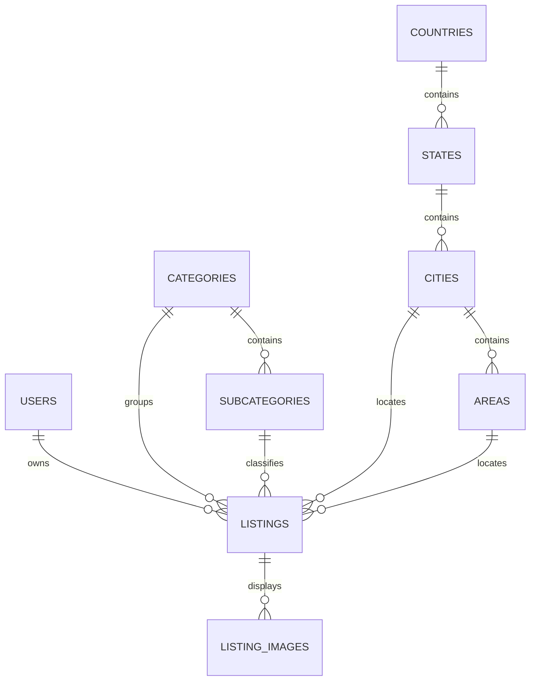

# MarketNest architecture and database

MarketNest is a Laravel 13 application. Blade renders pages, Vite builds custom CSS and vanilla JavaScript, and Eloquent queries MySQL. Laravel's web middleware handles cookie sessions and CSRF. No external services are needed to browse or seed the sample marketplace.

## Request flow

- Public GET routes render the homepage, browse results and listing details. `ListingBrowseController` validates query inputs and resolves category and city slugs. Scopes on `Listing` apply search, category, location, type and price filters in SQL, then sort and paginate results.
- Registration validates and hashes passwords before redirecting to login. The session controller preserves the intended URL, regenerates the session on login and invalidates it on logout.
- Authenticated listing writes go through `ListingRequest` and the ownership policy. `ListingPublisher` stores images on the public disk and writes listing and image metadata in a database transaction. It removes newly written files after a failed transaction and removes detached files after successful updates or deletions.

## Data model

A listing stores category, subcategory, city and area IDs. It derives country and state through the city's relationships. Composite foreign keys enforce that a selected subcategory belongs to its category and an area belongs to its city. Image records cascade when a listing is deleted. Country, state, city, category and ownership references otherwise use restrictive deletion rules. Prices use unsigned `DECIMAL(12,2)`, and public listing slugs are unique. See the [migrations](../database/migrations).

The public storage link exposes uploaded images and seeded demo copies. The archive includes the 28 original demo source illustrations, plus the migrations and seeders needed to reconstruct the data. The default seeder creates reference data. The optional demo seeder inserts fictional accounts and listings and copies the illustrations into storage.

The [assignment traceability table](phase-6-qa.md#assignment-requirement-traceability) maps registration, product and service publication, the ten required fields, and all four mandatory public page types to implementation and tests.
